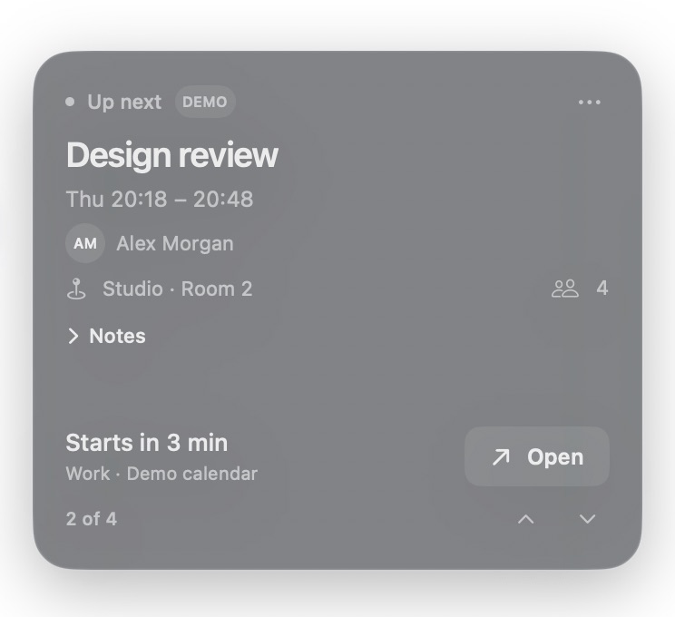

# Perch

Your next meeting, tucked behind the notch. Hover inside the notch to reveal your current or upcoming event; move away and the card slides out of view.

<p align="center">
  
</p>

Works with calendars synced to the macOS Calendar app, including Google and Outlook accounts. Requires **macOS 14 Sonoma or later** on Apple Silicon or Intel. No notch? Use the top center of your display.

## Install

1. Download the **universal ZIP** from the [latest release](https://github.com/Mamdasn/Perch/releases/latest).
2. Unzip it and move **Perch.app** to **Applications**.
3. Open Perch. From its menu-bar icon, choose **Settings → Calendars → Connect Calendar** and allow calendar access.

No build tools are needed. Enable **Launch at login** in **Settings → General** to start Perch automatically after restarting your Mac.

The release is not notarized by Apple. If macOS blocks it, use **System Settings → Privacy & Security → Open Anyway** only if you trust the download. See [Apple’s guidance](https://support.apple.com/102445).

## Use

- **Browse events:** scroll up or press ↑ for earlier events; scroll down or press ↓ for later events. The arrow keys work while the card is open and notes are collapsed.
- **Open or join:** click the event title to open it in Calendar, or click **Join** to open its meeting link. If there are multiple meeting links, choose the service from the menu.
- **See the details:** organizer, location, participant count, and your invitation response appear when available. Click anywhere on the **Notes** row to expand it. While expanded, scrolling over the row or the text scrolls the notes.
- **Get a quiet reminder:** a fine silver edge traces outward during the five minutes before a meeting and stays visible while a meeting is in progress. Toggle **Meeting highlight** in **Settings → General**.
- **Try a preview:** click **Load Demo Meeting** in **Settings → Calendars**. Your calendar returns when the preview closes.

Perch stays in the menu bar, including while Settings is open; it does not show a Dock icon. It reads events locally and never edits or uploads them. All-day and declined events stay hidden. Choose which calendars to show in Settings, or use **Disconnect Calendar** in General to stop loading events.

## Build and install from source

Install Apple’s Command Line Tools if needed:

```sh
xcode-select --install
```

Then run:

```sh
git clone https://github.com/Mamdasn/Perch.git
cd Perch
bash build-app.sh
```

The script builds for your Mac, replaces any existing installation in `/Applications`, and opens Perch. It requires write access to `/Applications`. Run it again to install source updates.

To run the checks after building:

```sh
.build/release/Perch --self-test
```

## Uninstall

Turn off **Launch at login**, quit Perch from its menu-bar menu, and move **Perch.app** from Applications to Trash.

## License

[GPL-3.0](LICENSE).
